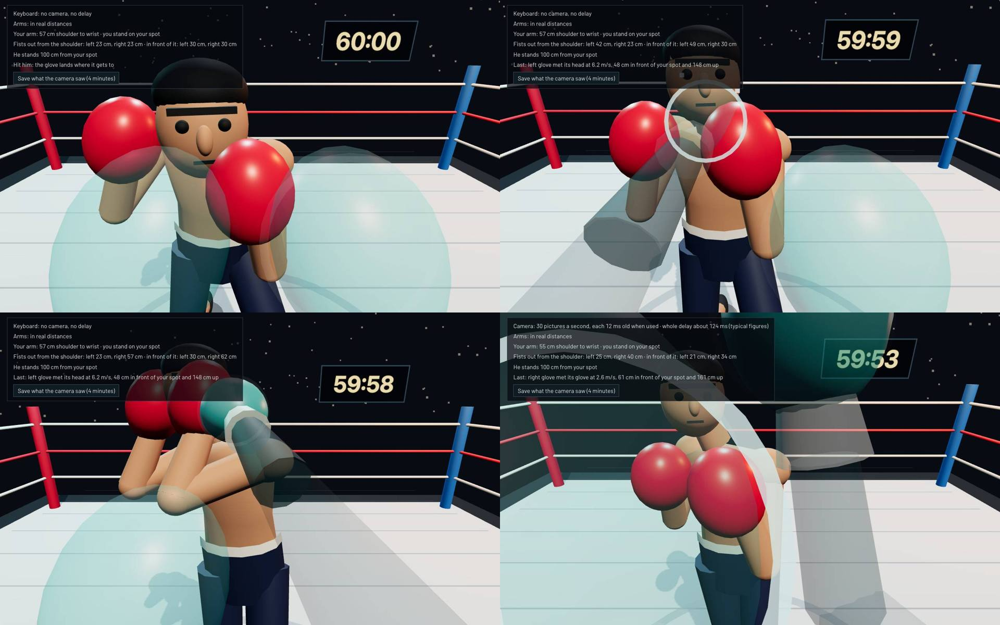

# SPAR

A browser game you play with your whole body. One ordinary webcam reads your pose, and a 3D avatar copies you 1:1 in real time: you box or play dodgeball against a bot by actually moving.



## What is in it

- **Real-time body tracking.** MediaPipe pose runs in a web worker and skips frames while busy. Results older than 250 ms are thrown away. A capture clock measures how old each frame is.
- **Motion filtering and prediction.** Joints are smoothed and arm bones keep a fixed length. A bench measures whether predicting ahead actually helps at the delay you really have (`pnpm eval:motion`).
- **Contact in real units.** Arms, reach and distance are worked out in centimetres. A punch counts when the glove meets the target, not when a gesture is recognised.
- **Replay for debugging.** You can save what the camera saw, then play it back (`?box=1&room&replay`) to find and fix tracking faults on real movement.
- **Deterministic simulation** with a shared protocol package and a small signalling server.

## Run it

```bash
pnpm install
pnpm dev        # web app + signalling server
pnpm test       # 1,100+ unit tests (Vitest)
```

Then open:

| URL | What it is |
| --- | --- |
| `/?box=1` | Boxing with your camera |
| `/?box=1&keys` | Boxing with the keyboard, no camera |
| `/?box=1&room` | Test room: live numbers + save a recording |
| `/?box=1&probe` | Camera check |
| `/?tap=1` | Dodgeball |

## Stack

TypeScript, React, Three.js, MediaPipe Tasks (pose), Vite, Vitest, pnpm workspaces.

The opponent's movement uses motion-capture clips from the CMU Graphics Lab Motion Capture Database.

Design spec: `docs/DESIGN.md` and `docs/RECOGNITION.md`. Screenshots and measurements: `docs/production/evidence/`.
